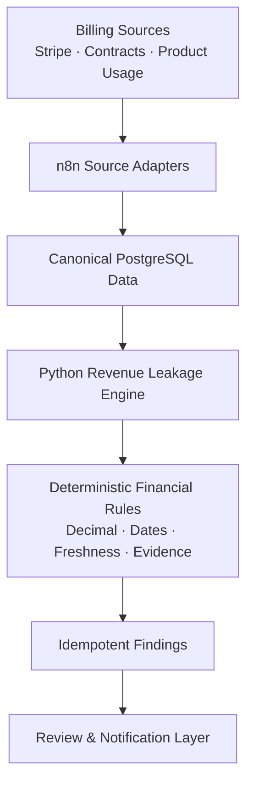
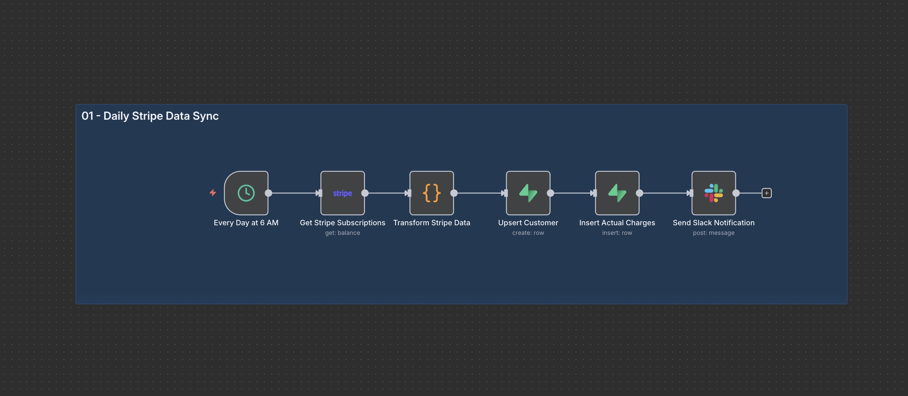
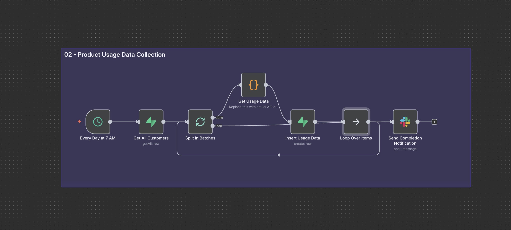
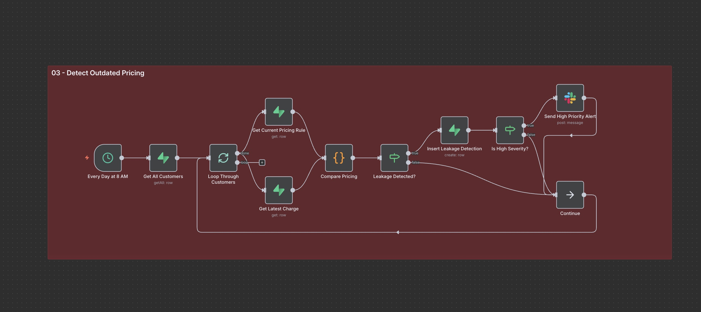
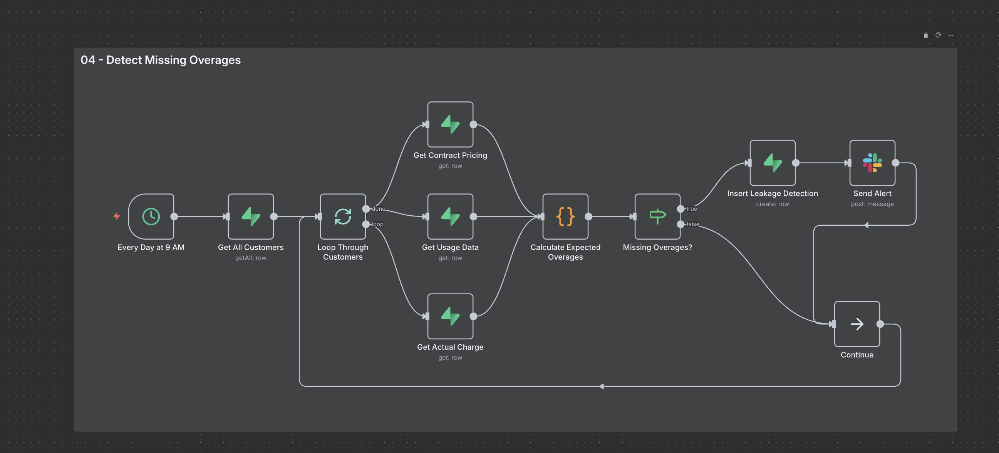
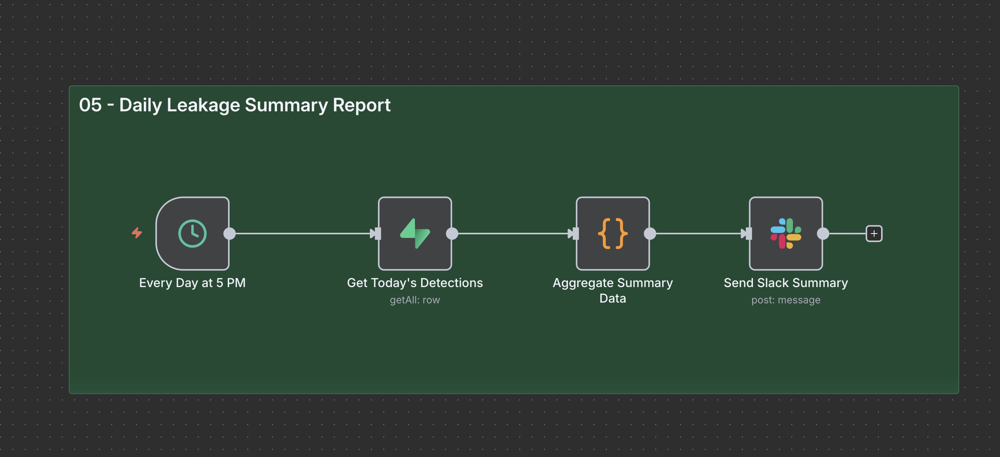

 # Revenue Leakage Detection System

<p align="center">
  <strong>Deterministic Financial Controls · Automated Billing Intelligence · Auditable Revenue Assurance</strong>
</p>

<p align="center">
  A tested reference implementation for identifying discrepancies between contractual billing expectations and actual customer charges through deterministic financial rules, evidence-backed findings, and workflow automation.
</p>

<p align="center">
  
  
  
  
  
</p>

<p align="center">
  <a href="#-overview">Overview</a> ·
  <a href="#-capabilities">Capabilities</a> ·
  <a href="#-architecture">Architecture</a> ·
  <a href="#-quick-start">Quick Start</a> ·
  <a href="#-benchmark">Benchmark</a> ·
  <a href="#-documentation">Documentation</a>
</p>

---

## Overview

Revenue Leakage Detection System is a financial controls engineering project designed to identify potential revenue discrepancies by comparing contractual billing expectations against actual charges and usage records.

The system combines deterministic Python rules, precise financial calculations, PostgreSQL persistence, and n8n orchestration to produce structured, auditable findings suitable for financial review.

Rather than relying on opaque predictions, the core detection engine uses explicit business rules, effective dates, source validation, and reproducible evidence.

> **Project status:** Tested reference implementation / portfolio system  
> **Domain:** Revenue Operations · Billing Controls · Financial Systems

This repository is not presented as a client deployment. No claims are made regarding recovered revenue, ROI, payback period, production coverage, or live business performance.

## At a Glance

| Component | Implementation |
|---|---|
| Detection engine | Deterministic Python rules |
| Financial precision | `Decimal`-based calculations |
| API layer | FastAPI |
| Data persistence | PostgreSQL |
| Workflow orchestration | n8n |
| Evidence model | Structured, versioned findings |
| Benchmark | 11 deterministic synthetic cases |
| Testing | Automated tests and reproducible benchmark |

---

## Capabilities

<details>
<summary><strong>01 · Contractual Pricing Validation</strong></summary>

Detects discrepancies between expected contractual pricing and actual billing.

- Outdated pricing detection
- Negotiated customer pricing validation
- Effective-date and end-date enforcement
- Grace-period handling
- Explicit currency validation

</details>

<details>
<summary><strong>02 · Usage and Overage Controls</strong></summary>

Evaluates usage records against billing expectations to identify potential unbilled revenue.

- Missing overage detection
- Duplicate usage-event validation
- Duplicate-finding suppression
- Source freshness validation
- Missing-data blocking

</details>

<details>
<summary><strong>03 · Discount and Entitlement Validation</strong></summary>

Validates billing conditions against customer-specific agreements and product entitlements.

- Discount validity checks
- Feature-entitlement mismatch detection
- Customer-specific pricing rules
- Contractual condition validation

</details>

<details>
<summary><strong>04 · Auditable Financial Findings</strong></summary>

Every evaluation produces a structured result designed for traceability and review.

Each finding includes:

- Rule identifier and version
- Customer reference
- Expected and actual financial values
- Calculated difference
- Estimated financial impact
- Severity and evaluation outcome
- Supporting evidence
- Deterministic finding key

</details>

<details>
<summary><strong>05 · Data Integrity and Reliability</strong></summary>

Financial comparisons incorporate explicit controls to reduce invalid or duplicate results.

- Exact decimal arithmetic
- Currency mismatch rejection
- Effective-date validation
- Source freshness checks
- Idempotent finding persistence
- Provenance-aware database records

</details>

---

## Architecture

The system separates financial decision logic from workflow orchestration, making the detection engine independently testable and reproducible.



### Design Principles

| Layer | Responsibility |
|---|---|
| Source adapters | Extract and normalize billing, contract, and usage data |
| PostgreSQL | Store canonical records, provenance, and findings |
| Python engine | Execute deterministic financial comparisons |
| FastAPI | Expose the detection service |
| n8n | Manage connectors, schedules, and notifications |
| Review layer | Support downstream review of detected discrepancies |

**Key architectural decision:** Financial comparison logic resides in `src/revenue_leakage`, rather than inside n8n workflows. This keeps the rules independently testable and separates business logic from orchestration.

---

## Quick Start

### Prerequisites

- Python 3.11
- PostgreSQL
- Git
- Optional: n8n for workflow orchestration

### 1. Clone the repository

```bash
git clone <repository-url>
cd <repository-directory>
```

### 2. Create the Python environment

```bash
python3.11 -m venv .venv
```

Activate the environment:

**Linux / macOS**

```bash
source .venv/bin/activate
```

**Windows PowerShell**

```powershell
.venv\Scripts\Activate.ps1
```

### 3. Install dependencies

```bash
python -m pip install --upgrade pip
pip install -e ".[dev]"
```

The committed `uv.lock` records the resolved dependency graph. CI uses:

```bash
uv sync --locked --extra dev
```

### 4. Run quality checks

```bash
ruff format --check .
ruff check .
pytest
```

### 5. Reproduce the synthetic benchmark

```bash
PYTHONPATH=src python scripts/run_synthetic_benchmark.py
```

### 6. Start the API service

Set the service token before starting the application.

**Linux / macOS**

```bash
export LEAKAGE_ENGINE_TOKEN="local-secret"
python -m revenue_leakage
```

**Windows PowerShell**

```powershell
$env:LEAKAGE_ENGINE_TOKEN = "local-secret"
python -m revenue_leakage
```

Use a securely generated secret for any deployment beyond local testing.

### 7. Initialize PostgreSQL

```bash
psql -v ON_ERROR_STOP=1 -f database/schema.sql
psql -v ON_ERROR_STOP=1 -f database/sample-data.sql
```

---

## Synthetic Benchmark

The repository includes a frozen benchmark containing 11 deterministic synthetic cases.

These fixtures evaluate the implemented rules against predefined expected outcomes.

### Benchmark Results

| Metric | Result |
|---|---:|
| True Positives | 4 |
| True Negatives | 7 |
| False Positives | 0 |
| False Negatives | 0 |
| Precision | 100% |
| Recall | 100% |

<p align="center">
  
  
  
</p>

### Interpretation

The benchmark demonstrates that the encoded rules correctly classify the committed synthetic fixtures.

**Important limitation:** These results do not establish accuracy on unseen contracts, production invoices, or real customer data. The benchmark is a designed test set, not an independently validated production evaluation.

<details>
<summary><strong>View benchmark artifacts</strong></summary>

- [Synthetic benchmark cases](./benchmarks/synthetic_cases.json)
- [Machine-readable benchmark results](./results/synthetic_benchmark.json)
- [Benchmark execution script](./scripts/run_synthetic_benchmark.py)

</details>

---

## Evidence and Implementation Status

Transparency is a core design principle of this project.

| Area | Evidence Status |
|---|---|
| Python detection rules and service | Implemented and tested |
| PostgreSQL schema and sample data | Implemented and tested |
| Idempotent finding persistence | Implemented and tested |
| n8n workflow artifacts | Implemented; not live-provider verified |
| Workflow screenshots | Design evidence |
| Benchmark metrics | Synthetic benchmark |
| Production detection and recovery | Not established |
| Client or business outcomes | Not claimed |

---

## Workflow Visuals

The following workflow diagrams document the orchestration design.

<details>
<summary><strong>01 · Stripe Data Synchronization</strong></summary>



</details>

<details>
<summary><strong>02 · Usage Collection</strong></summary>



</details>

<details>
<summary><strong>03 · Outdated Pricing Detection</strong></summary>



</details>

<details>
<summary><strong>04 · Missing Overage Detection</strong></summary>



</details>

<details>
<summary><strong>05 · Daily Leakage Summary</strong></summary>



</details>

<sub>Note: These screenshots document the earlier orchestration design and may not match the refactored service boundary node-for-node.</sub>

---

## Documentation

| Document | Description |
|---|---|
| [Architecture](./docs/architecture.md) | System components and design decisions |
| [Evidence](./docs/evidence.md) | Implementation evidence and validation |
| [Reliability Controls](./docs/reliability.md) | Data integrity and reliability mechanisms |
| [Synthetic Benchmark](./benchmarks/synthetic_cases.json) | Deterministic benchmark fixtures |
| [Benchmark Results](./results/synthetic_benchmark.json) | Machine-readable evaluation results |

---

## Deployment Roadmap

The following items represent remaining work before a production deployment could be considered.

- [ ] Validate Stripe and product adapters against real test-mode accounts
- [ ] Configure and verify platform-managed credential scopes
- [ ] Implement tenant authorization and PostgreSQL row-level security
- [ ] Add production observability and operational monitoring
- [ ] Test notification delivery and failure handling
- [ ] Build a review and approval interface
- [ ] Evaluate against a representative, independently labeled historical dataset
- [ ] Establish validated operational metrics before making business-value claims

---

## Project Context

This repository is a portfolio-oriented engineering implementation exploring the intersection of financial systems, deterministic business rules, workflow automation, and data reliability.

The emphasis is on **reproducibility, financial precision, traceability, and honest evidence of implementation**.

### Author

**Ugo Chukwu / Etherlabs**

### License

Distributed under the [MIT License](./LICENSE).

---

<p align="center">
  <strong>Revenue integrity begins with reliable data, explicit rules, and auditable evidence.</strong>
</p>

<p align="center">
  <a href="#-overview">Back to top ↑</a>
</p>
