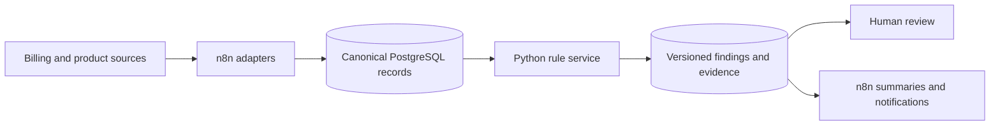

# Architecture

This document describes the implemented reference architecture, not a verified production deployment.

## Responsibility boundaries

- **n8n:** source-specific connectivity, schedules, normalized event delivery, service invocation and notifications.
- **Python:** contract precedence, effective dates, usage calculations, discounts, entitlements, grace periods, Decimal/currency policy, freshness and finding identity.
- **PostgreSQL:** canonical source records, uniqueness constraints, exact financial fields and idempotent unresolved-finding persistence.
- **Human review:** confirmation and remediation. Detection never changes a customer contract or invoice automatically.

Every evaluation returns `rule_id`, `customer_id`, `expected_value`, `actual_value`, `difference`, `impact_estimate`, `severity`, `evidence`, `rule_version`, `outcome`, `currency`, and a deterministic `finding_key`. Missing, stale or cross-currency inputs produce `blocked`, not a false `clear` result.

Customer-specific negotiated terms take precedence over catalog terms only when the customer, plan and effective billing date match. Replayed usage events are collapsed by event ID; conflicting replays fail. The database keeps one active finding per key while updating `last_seen_at` on repeated detections.

## Deployment gaps

Live provider compatibility, tenant authorization/RLS, notification delivery, production scale and representative historical accuracy remain unverified. The workflow screenshots capture the original visual design and are retained as design evidence, not execution proof.
